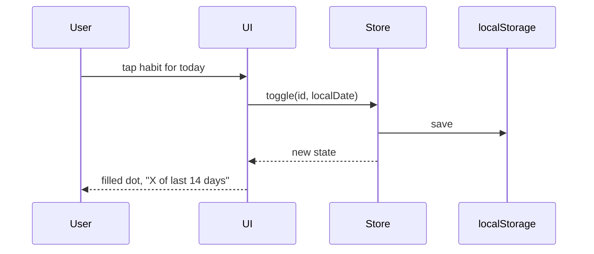

# Architecture
## Overview
Notch is a static, offline-first PWA. All state is in the browser's localStorage; there is no server.
## Components
- `src/store.js`: pure logic (add/rename/delete habit, toggle date, set/clear a day note, count last N days, cap of 5, export/import JSON) plus load/save to a storage object.
- `src/ui.js`: renders habit rows and the 14-dot strip (each dot a button opening the inline note field), handles taps and keyboard.
- `index.html`, `style.css`: shell and styles using the brief's palette.
- `sw.js`, `manifest.json`: offline cache and installability.
## Data model
`{ habits: [{ id, name, done: ["YYYY-MM-DD", ...], notes?: { "YYYY-MM-DD": "text <=140" } }] }`, at most 5 habits. `notes` is optional (absent in older saves); see ADR 0003. Misses are never stored.
## Core flow

## Test strategy
Unit tests on `store.js` through its public functions with hand-worked expected values and an injected clock and storage; DOM kept thin. One command: `node --test`.
## Run it
No install. Serve: `python3 -m http.server 8000`, open http://localhost:8000. Test: `node --test`.
